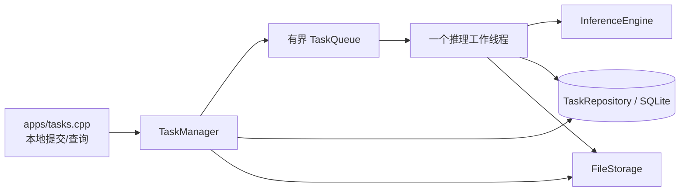

# 架构与阶段

阶段1是同步单图 CLI，继续保留：

```text
apps/infer.cpp
    → prepare_image / prepare_rgb
    → InferenceEngine
    → 单次前向 predictions + raw P3
    → 检测/NMS/选框 → RoIAlign/L2 → 精确欧氏1NN/top8
    → JSON结果
```

阶段2已实现 C++17、单进程、一个任务推理工作线程：



TaskRepository 保存 QUEUED/RUNNING/SUCCEEDED/FAILED 当前状态。FileStorage 保存真实输入副本和结果文件。有界队列只保存任务 ID、类别、受控路径。模型和五类正常库在工作线程启动时初始化一次。任务工作线程和已有检索中的4个OpenMP线程是不同层次。

队列使用预分配环形槽位，在容量检查后、发布前提交数据库记录，避免正常运行中满队列留下孤立记录。正常退出排空已接受任务；系统故障停止接收，保留记录供检查。未完成任务不自动恢复。

阶段3已实现本机 HTTP 上传/查询：`apps/http.cpp → HttpServer → TaskManager`，固定监听 127.0.0.1。POST /tasks 接收 image/asset multipart 表单，GET /tasks/ID 和 /result 查询任务与结果；HTTP 线程池与唯一推理工作线程分别管理。正常 SIGINT/SIGTERM 先停 HTTP，再排空任务。

阶段4再添加中断恢复、完整停止策略和 systemd 示例。视频文件和实时流需要单独设计。当前没有 Redis 或消息中间件。

执行失败与检测异常必须区分。现在只输出异常分数；没有冻结阈值，不把 label 传给算法，也不把无框或无正常库当正常。

先读 [阶段二代码阅读指南](stage2-reading-guide.md) 了解已实现代码、运行方式和验证结果；[阶段二实施指南](stage2-task-system.md) 保留为设计草图和验收参考。

HTTP 运行方法、接口合同、上传实现和测试范围见 [阶段三代码阅读指南](stage3-reading-guide.md)。
