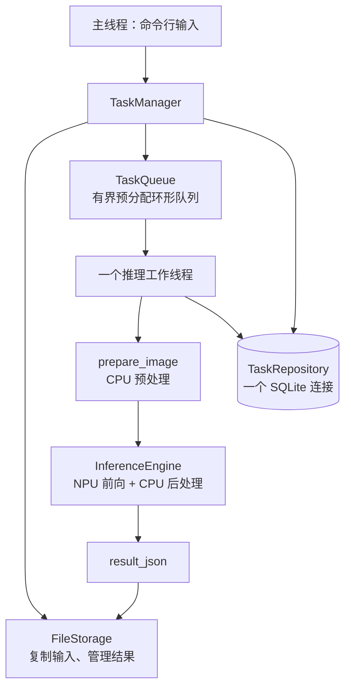
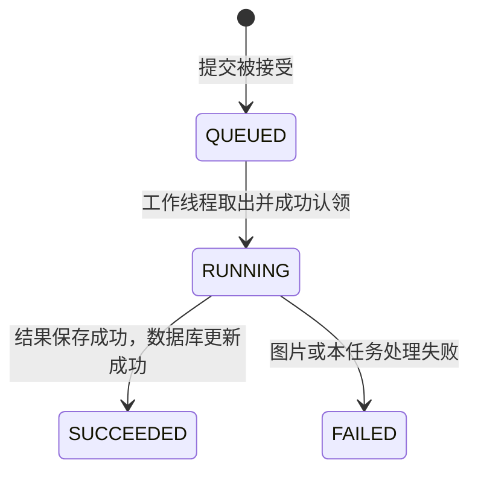

# 阶段二代码阅读指南：从提交图片到查询任务结果

阶段三已增加独立 HTTP 入口，见 [阶段三阅读指南](stage3-reading-guide.md)。本篇继续说明阶段二本地交互程序，二者共用 TaskManager。

这份文档对应已经实现的阶段二代码。建议一边运行 `edgeinspect_tasks`，一边按下面的阅读顺序看源码。原来的 [阶段二实施指南](stage2-task-system.md) 保留为设计与验收清单；如果其中的接口草图与最终代码略有不同，以本指南和源码为准。

当前实现：单进程、一个推理工作线程、有界 FIFO、SQLite、输入副本、结果 JSON、本地交互命令和正常退出。HTTP、视频、自动恢复、取消和优先级尚未实现。

## 1. 先运行一次，看到真实数据

在项目根目录编译：

```bash
cmake -S . -B artifacts/build -DCMAKE_BUILD_TYPE=Release
cmake --build artifacts/build --parallel 2
ctest --test-dir artifacts/build --output-on-failure
```

需要现有板端 SDK、模型、正常库、OpenCV/OpenSSL 开发包，以及 SQLite 开发包。程序仍然通过 RKNN Runtime 运行 NPU，不会调用 Python 推理。

启动新的任务程序：

```bash
artifacts/build/edgeinspect_tasks \
  --root "$PWD" \
  --data-root artifacts/task-service \
  --queue-capacity 10
```

只有工作线程成功加载模型和五类正常库后，才输出类似：

```json
{"event":"READY","engine_initializations":1,"data_root":"/项目目录/artifacts/task-service"}
```

在这个程序的提示符中输入（不是另开 Shell 执行）：

```text
submit --image samples/normal.jpg --asset glass-insulator
list
```

程序返回一个 32 位十六进制随机 ID。例如下面的 ID 仅为说明，使用时替换成你自己收到的 ID：

```json
{"event":"ACCEPTED","task_id":"bc76929032275b83d5f94ea6b1e5e780"}
```

接着在同一程序中输入：

```text
get bc76929032275b83d5f94ea6b1e5e780
wait bc76929032275b83d5f94ea6b1e5e780
result bc76929032275b83d5f94ea6b1e5e780
quit
```

- `get` 立即查询任务状态。
- `wait` 最多等 30 秒，直到任务到达成功或失败状态；不取消任务。
- `result` 读取成功任务保存的完整结果 JSON。
- `quit` 停止接收并排空已接受任务，然后退出。标准输入 EOF 也执行同样的正常关闭。

输入图片路径带空格时，使用双引号：

```text
submit --image "/home/ubuntu/my images/normal.jpg" --asset glass-insulator
```

已有教学程序 `edgeinspect_repository_init` 只是数据库示例，会插入固定 ID 和示例路径，不负责执行任务。不要把它产生的未完成记录当成新服务可恢复的任务。使用一个新的 `data_root` 启动任务程序。

## 2. 一个任务实际保存在哪里

```text
artifacts/task-service/
  .lock                         防止两个服务同时使用同一个数据根目录
  tasks.sqlite3                 所有任务共用的数据库
  tasks/
    bc76929032275b83d5f94ea6b1e5e780/
      input.bin                 实际复制的 JPG/PNG 压缩字节
      result.json               推理成功并保存后才出现
```

`input.bin` 不是预处理后的 RGB。它是原始图片文件的副本，只是使用固定名字；图片格式按文件内容识别。工作线程调用 `prepare_image()` 后，RGB 才在内存中生成。

`TaskRecord.input_path` 保存相对路径：

```text
tasks/<id>/input.bin
```

完整路径由 FileStorage 把它拼到自己的规范化根目录下。TaskRepository 不创建图片，FileStorage 才创建实际文件。

一个数据库、一张 tasks 表、每个任务一行；不是一个任务一个数据库。表有 10 列：

| 列 | C++ 成员 | 内容 |
| --- | --- | --- |
| task_id | id | 唯一任务编号 |
| asset | asset | 部件类别 |
| status | status | 四种执行状态之一 |
| input_path | input_path | 输入副本相对路径 |
| result_path | result_path | 成功结果相对路径，可为空 |
| created_at | created_at | 创建记录时间 |
| started_at | started_at | 开始处理时间，可为空 |
| finished_at | finished_at | 结束时间，可为空 |
| error_code | error_code | 错误类别，可为空 |
| error_message | error_message | 错误描述，可为空 |

在另一个终端查看：

```bash
sqlite3 -header -column artifacts/task-service/tasks.sqlite3 \
  'SELECT task_id,status,input_path,result_path,error_code FROM tasks;'
```

JSON 保存完整推理结果；数据库保存可查询的任务当前状态；终端日志提供运行过程和系统故障线索。任务表不保存所有历史状态事件。

## 3. 建议的源码阅读顺序

| 顺序 | 文件 | 先找什么 |
| --- | --- | --- |
| 1 | [apps/tasks.cpp](../apps/tasks.cpp) | `main()`、命令分发、`manager.start()` |
| 2 | [task.h](../include/edgeinspect/task.h) | TaskStatus、TaskRecord、QueuedTask、TaskError |
| 3 | [task_manager.cpp](../src/task_manager.cpp) | `submit()`，再读 `Impl::run()` |
| 4 | [task_queue.cpp](../src/task_queue.cpp) | `try_push()`、`wait_pop()`、`close()` |
| 5 | [task_repository.cpp](../src/task_repository.cpp) | Statement、insert/get、三个 mark 函数 |
| 6 | [file_storage.cpp](../src/file_storage.cpp) | `copy_input()`、`resolve()`、`write_result()` |
| 7 | [task.cpp](../src/task.cpp) | 状态转换、UTC 时间和任务 JSON |
| 8 | [task_system_test.cpp](../tests/task_system_test.cpp) | 每种错误场景如何构造 |

不要一开始按 include 顺序逐行啃完。先沿一个正常任务走通，再看锁、RAII 和错误路径。

## 4. 模块之间如何连接



CMake 关系：

```text
edgeinspect_tasks（新可执行程序）
  → edgeinspect_tasks_lib（任务系统静态库）
      → edgeinspect_engine（原推理库）
      → SQLite、Threads

edgeinspect_cli（原单图可执行程序）
  → edgeinspect_engine
```

`#include` 使编译器知道接口；`target_link_libraries` 让最终程序找到实现。现在任务库调用了已有引擎和 JSON/文件函数，因此任务库也链接推理库。

## 5. 第一个入口：apps/tasks.cpp

启动参数：

| 参数 | 含义 | 默认 |
| --- | --- | --- |
| --root | 模型和正常库所在的项目根目录 | 当前工作目录 |
| --data-root | 数据库和任务文件目录 | 必填 |
| --queue-capacity | 等待任务容量，不含正在运行任务 | 10，范围 1..100000 |
| --max-bytes | 输入副本和图片入口的字节上限 | 33554432 |
| --max-pixels | 图片解码前的像素上限 | 24000000 |
| --help | 显示帮助 | 退出，不加载模型 |

程序先构造 TaskManager，再调用 `start()` 等待引擎就绪，之后才进入命令读取循环。命令错误会返回错误 JSON，但通常保留交互会话；系统故障或启动失败以非零状态退出。

交互命令：

| 命令 | 行为 |
| --- | --- |
| submit --image PATH --asset ASSET | 保存副本、登记并排队，返回 ID |
| get ID | 读取一条任务记录 |
| list [LIMIT] | 最近记录，默认 20，范围 1..1000 |
| result ID | 读取 SUCCEEDED 任务的结果文件 |
| wait ID [TIMEOUT_MS] | 等待终态，默认 30000，最大 600000 毫秒 |
| health | 查看服务是否出现系统故障，正常时 fault 为 null |
| help | 显示帮助 |
| quit | 排空正常接受的任务后退出 |

`wait` 会阻塞当前交互线程，但工作线程继续处理；等待超时仅结束这次等待，不中断推理。RKNN Runtime 可能另外打印自己的诊断信息，不要假定所有标准输出行都是 JSON。

## 6. 提交一张图片：TaskManager::submit()

按下面的调用顺序阅读：

```text
asset_class(asset) 检查类别
    → 检查 Ready 状态
    → FileStorage::copy_input() 保存副本，生成随机 ID
    → 组装 TaskRecord 和 QueuedTask
    → TaskQueue::try_push(task, before_publish)
         → 检查队列关闭/容量
         → before_publish 调用 repository.insert_queued()
         → 数据库提交成功后发布队列槽位
    → 返回 ID
```

`TaskRecord` 是数据库和查询使用的完整记录；`QueuedTask` 只有 ID、类别、受控相对路径。队列没有图片像素或模型。

源文件不存在、为空、超字节限制、类别不支持等，在接收前拒绝。图片内容损坏通常到工作线程解码时才发现，任务进入 FAILED。

队列满时，before_publish 不执行，因此数据库没有新行；已复制的本次输入目录会被清理。拒绝提交不产生永久等待的任务。

代码让 `std::function<void()> before_publish` 在队列锁内运行。这里只有一次短数据库插入，不能在这个回调中调用队列自身、推理或复制图片。

## 7. 为什么使用环形队列，而不是照草图直接用 deque

设计文档最初给出 deque 建议；最终使用启动时分配好的 `vector<optional<QueuedTask>>` 环形槽位，目的是减少“数据库已经提交，入队时却分配内存失败”的窗口。

成员含义：

```text
head_：下次从哪里取
 tail_：下次向哪里放
count_：当前等待数量
slots_：固定容量的槽位
closed_：不再接受新任务
```

`try_push()` 在同一把锁内完成容量判断、数据库回调和发布。QueuedTask 只包含可无异常移动的字符串，代码用 static_assert 检查移动构造保证；提交后发布不会再为队列分配节点。

`wait_pop()` 使用条件变量：

```cpp
readable_.wait(lock, [&] { return closed_ || count_; });
```

队列为空时线程休眠；有任务或关闭时唤醒，谓词也处理虚假唤醒。取出任务后立刻释放队列锁，不拿着它推理。

正常 `close()` 拒绝新任务，但允许已有任务排空。系统故障时工作线程停止，遗留排队记录留给人工检查，不假装全部完成。

这个协调方案保护正常进程中的发布，不提供数据库和文件系统之间的分布式事务，也不承诺崩溃后恰好执行一次。

## 8. 真正处理任务：Impl::run()

工作线程一启动先调用 factory，默认工厂建立一个 InferenceEngine。创建和释放都发生在这个线程，多个任务复用同一个引擎。

`promise/future` 用来传递启动结果：主线程等待 `start()`，工作线程初始化成功后通知；初始化失败则把异常传回，不能永远卡在等待 READY。

运行循环：

```text
wait_pop()
    → QUEUED 条件更新为 RUNNING
    → 根据受控路径找到 input.bin
    → prepare_image()
    → engine.infer()
    → result_json()
    → 独占创建 result.json
    → RUNNING 条件更新为 SUCCEEDED
    → 取下一任务
```



默认处理器在 `real_processor()` 中，只有这段负责把阶段二与已有预处理和引擎串起来。它返回的字符串就是原 `result_json()` 的内容，没有额外包装成阶段一 CLI 的 `runs` 数组。

FAILED 的含义是执行错误；SUCCEEDED 并不表示部件正常。当前结果仍是 score 加空阈值/空异常判断，没有更改算法和正常库。

## 9. 数据库代码怎么读

`TaskRepository::Impl` 持有一个 SQLite 连接和一把 mutex。每次查询或状态更新整个操作都在锁内，statement 不跨方法借出。

`Statement` 是内部小工具，包装了：

```text
构造         → sqlite3_prepare_v2
bind         → sqlite3_bind_text，检查 NUL 和长度
step/execute → sqlite3_step，检查 SQLITE_ROW / SQLITE_DONE
required     → 读取不允许为空的文字列
optional     → SQL NULL 转为 std::nullopt
析构         → sqlite3_finalize
```

`get()` 的 SELECT 列与 record() 里的列号一一对应，从 0 开始。绑定问号参数则从 1 开始。返回字符串复制到 TaskRecord，不借用 SQLite 的内部指针。

三个更新使用条件 WHERE，例如：

```sql
UPDATE tasks
SET status='RUNNING', started_at=?
WHERE task_id=? AND status='QUEUED';
```

`sqlite3_changes()==1` 才算转换成功。TaskManager 把没有更新到一行当成一致性错误，不忽略。

时间由 Repository 在状态转换时生成 UTC 毫秒字符串，不能把测试中的固定示例时间当作真实时间。推理耗时仍由原引擎的 steady_clock 计算。

`list()` 限制条数，按创建时间和 ID 倒序，不提供无限全表导出。`has_incomplete()` 用于阻止阶段二自动接手中断前的任务。

## 10. FileStorage 做了哪些实际工作

- 把 data_root 规范化为绝对路径，持有 `.lock` 文件上的进程级 flock；另一个服务不能同时拥有该根目录。
- 使用系统随机源生成 128 位随机 ID，独占创建任务目录，避免同名覆盖。
- 打开源文件后用 fstat 检查普通文件和大小；复制过程中继续计数字节，文件增长也不能突破上限。
- 输入副本为普通图片压缩字节，副本完成后才登记任务。提交后的源文件变化不影响副本；复制过程中源文件被修改不属于一致快照保证。
- 错误时清理本次尚未发布任务的目录；已经完成的任务文件不会被自动清理。
- resolve() 只接受 `tasks/<32位十六进制ID>/input.bin` 或 `result.json`，拒绝任意路径和检测到的符号链接。
- 结果沿用 `save_new_file()` 独占创建，拒绝覆盖，失败时清理部分结果文件。

这是受控本地目录设计，不是面对拥有目录写权限的恶意进程的隔离沙箱。任务目录应由服务用户管理。当前没有历史数据保留期限或磁盘配额，需要人工管理；有界队列并不能限制长期磁盘占用。

## 11. 出错后发生什么

| 情况 | 处理 |
| --- | --- |
| 非法类别 | INVALID_ASSET，提交被拒绝 |
| 无效源文件、超字节限制 | INVALID_INPUT，提交被拒绝 |
| 队列满 | QUEUE_FULL，清理本次副本，无新任务行 |
| 图片损坏、像素超限 | 该任务 FAILED / INVALID_INPUT，继续下一任务 |
| 本任务结果保存失败 | FAILED / STORAGE_ERROR，继续下一任务 |
| RKNN/未知处理错误 | 尝试记录该任务失败，服务进入 fault，停止接收 |
| 数据库写入或状态更新失败 | 服务进入 fault，不误报成功 |
| 结果已写但最终状态更新失败 | 保留文件和可能的 RUNNING 记录，供后续对账 |
| 不存在的 ID | NOT_FOUND |
| 任务未成功时取结果 | NOT_READY |

TaskError 是 `runtime_error` 的派生类，额外携带 code。CLI 输出 code/message，调用者不需要从英文错误文本猜类别。

数据库记录和文件写入无法共同原子提交。阶段二仍不做断电/崩溃恢复：已有 QUEUED/RUNNING 时启动报告 INCOMPLETE_TASKS，保留原数据；选择新的 data_root 或人工检查，不自动删库。

同一个实例只能 start 一次；正常 stop_and_drain() 可重复调用。生命周期操作由控制线程调用，不能在处理器回调里调用 stop/join 自己。

如果驱动调用卡住，正常 join 也可能等待；此处不承诺用线程超时终止 RKNN。SIGINT/SIGTERM 恢复策略、自动重试和 systemd 属于后续阶段。

## 12. 如何验证这份实现

基础测试：

```bash
ctest --test-dir artifacts/build --output-on-failure
```

新增 `edgeinspect_task_system` 测试不启动 NPU，利用可注入 ProcessorFactory 确定性地制造等待、失败和队列满，覆盖：

- 插入/查询、条件更新、重复 ID、持久化、非法状态。
- FIFO、环形回绕、队列满不执行入库回调、入库失败不发布、关闭唤醒和排空。
- 输入副本、超限、路径拒绝、不覆盖结果、同 data_root 互斥。
- 一个处理器初始化一次且不重叠调用、坏任务后继续、拒绝提交不留记录/文件、4 个并发提交者的 20 个任务排空。
- 启动失败握手、未完成任务拒绝恢复。
- SQL trigger 注入插入失败/最终更新失败，以及结果路径冲突导致保存失败。

真实板端验证：

```bash
python3 -B tests/validate_stage2.py
```

它自动启动任务进程、提交正常/坏图/异常图、查询和等待，检查源文件变化后的副本、历史查询、启动错误，再与阶段一 CLI 结果比较。每次创建独立运行目录，不覆盖之前的服务数据。

### 本次实际验证记录（2026-11-09）

- 全部目标编译成功，无新增编译告警。
- CTest：3/3 通过（任务系统、原 core、检测协议）。
- 真实板端脚本：22 项检查通过，报告位于 [stage2 report](../artifacts/runs/stage2_20261109_215010_565753/report.json)。
- 正常样例分数 `0.6873426511883736`，异常样例分数 `0.7032674252986908`；分数、框、fallback、输入/RGB/正常库哈希等与阶段一 CLI 完全一致。这两个分数不构成报警阈值。
- 原 `validate_stage1.py` 尝试运行，但冻结源码哈希门禁失败：工作区原有 `apps/infer.cpp` 注释/格式改动与 `assets/source_manifest.json` 不一致。本次保留了这些用户改动，没有更新基准或跳过门禁，故不能声称阶段一完整基础脚本通过。失败报告位于 [stage1 report](../artifacts/runs/stage1_20261109_214638_720544/comparison.json)。
- 未执行需要外部冻结数据集的完整回归，没有 HTTP、视频或全量 AUROC 验证结论。

上述 artifacts 是本机生成、Git 忽略的证据，克隆源码后不会自动带上；可运行脚本生成自己的报告。

## 13. 推荐的自学练习

1. 提交一张图，结合 get、SQLite 查询和任务目录观察同一个 ID。
2. 提交一个内容为普通文字但扩展名为 .jpg 的文件，观察 FAILED 和错误字段；再提交正常图，确认继续工作。
3. 阅读测试中的 manager_checks()：它用 promise/future 卡住第一个任务，保证后两个排队，稳定验证 QUEUE_FULL，而不是依赖手速。
4. 跟踪一遍 `submit → copy_input → try_push → insert_queued → wait_pop → mark_running → real_processor → write_result → mark_succeeded`。
5. 最后读 failure_checks()，理解“本任务失败”和“整个服务不再可信”的区别。

理解这条链路后，阶段三 HTTP 接口只需复用 submit/get/result 等能力，不应在请求处理线程中直接并发调用同一个 InferenceEngine。
