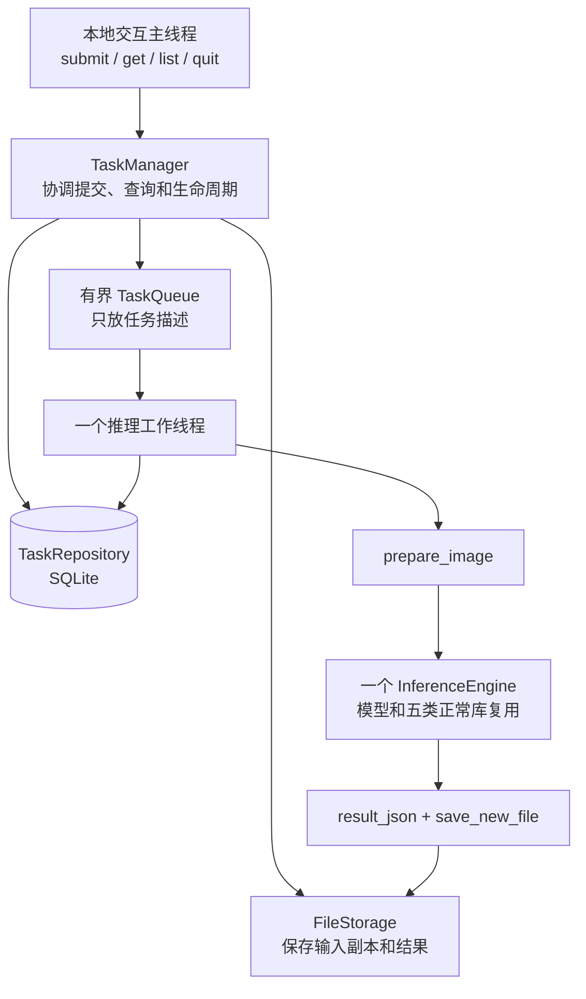
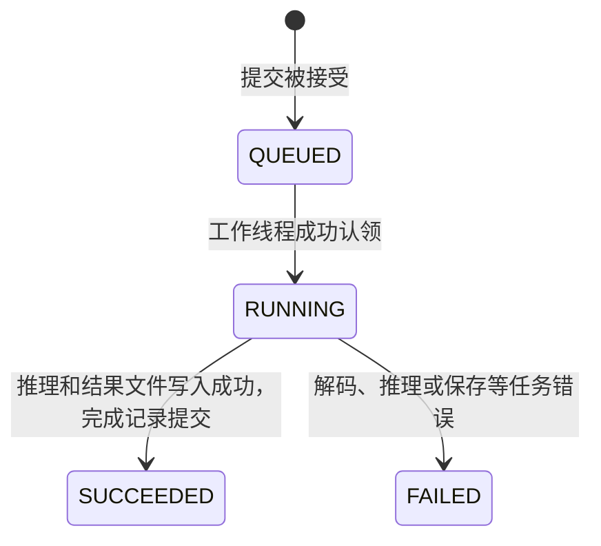

# 阶段二实施指南：搭建本地任务系统

实现状态更新：阶段二现已提供可运行代码，见 [阶段二代码阅读指南](stage2-reading-guide.md)。下文保留原实施设计；接口草图和队列实现细节以实际源码及阅读指南为准。

本文依据编写时的 `docs/architecture.md` 和阶段一接口编写，供逐步实现使用。本文中的接口和配置保留为**原建议设计**；实际可运行命令和最终实现见阅读指南，未实现部分仍以后续阶段说明为准。

阶段二的目标：在一个常驻进程中持续接收图片任务，通过一个有界队列和一个推理工作线程执行，使用 SQLite 记录状态，通过本地命令提交和查询。阶段一的检测、ROI、评分算法和数值协议保持原样。

## 1. 为什么推理写完了，还需要任务系统

阶段一回答：给定一张图片和类别，如何得到一次推理结果？

阶段二回答：多张图片接连到来时，谁先执行、谁在等待、怎样查结果、失败如何记录？

假设提交 A、B、C 三张图片：

| 时刻 | A | B | C |
| --- | --- | --- | --- |
| 提交之后 | RUNNING | QUEUED | QUEUED |
| A 完成 | SUCCEEDED | RUNNING | QUEUED |
| B 图片解码失败 | SUCCEEDED | FAILED | RUNNING |
| C 完成 | SUCCEEDED | FAILED | SUCCEEDED |

B 的单任务错误不会自动导致 C 被放弃。数据库损坏、引擎无法初始化等系统错误则需要单独处理，不能伪装成普通图片失败。

`SUCCEEDED` 只表示处理和结果保存成功，不表示部件正常。当前没有校准报警阈值，继续输出分数，`anomaly_threshold`、`is_anomaly` 仍为空。

## 2. 范围和完成标准

本阶段实现：

- C++17、一个进程、一个长期存活的推理工作线程。
- 先进先出（FIFO）的有界内存队列。
- `QUEUED / RUNNING / SUCCEEDED / FAILED` 状态及查询。
- SQLite 任务记录、受控输入副本、结果 JSON。
- 同一进程内的本地提交、查询、退出入口。
- 基础资源释放、工作线程唤醒和正常退出。

后续阶段再实现：HTTP 上传/查询、视频文件和实时流、优先级、取消/自动重试、多引擎并发、用户账号、进程中断恢复、完整停止策略和 systemd 部署。SQLite 持久化任务记录不等于自动恢复任务。

验收重点：连续提交任务时不重复加载模型，同一引擎没有并发调用，队列满有明确反馈，成功和失败可查询，原有 CLI 和数值行为不退化。

## 3. 整体架构与线程



主线程负责命令和查询，工作线程负责图片预处理、推理和保存。不要拿数据库锁或队列锁执行推理。

工作线程内的正常库检索仍可能使用已有的 4 个 OpenMP 线程。这与“一个任务工作线程”是两个层次，不能据此声称进程只有一个 CPU 线程。

## 4. 建议的文件组织

```text
include/edgeinspect/
  inference_engine.h       已有接口，继续复用
  task.h                   TaskStatus、TaskRecord、QueuedTask
  task_queue.h             有界队列
  task_repository.h        SQLite 读写接口
  file_storage.h           受控输入和结果路径
  task_manager.h           提交、查询、启动和退出
src/
  task_queue.cpp
  task_repository.cpp
  file_storage.cpp
  task_manager.cpp         工作循环可先放这里
apps/
  infer.cpp                保留现有单图 CLI
  tasks.cpp                新的常驻本地交互入口
tests/                    测试名称按实际实现调整
  task_queue_test.cpp
  task_repository_test.cpp
  task_system_test.cpp
```

先把功能分清，再决定是否把工作循环拆成单独的 `task_worker.cpp`。不要为每个小函数建立一个类。

运行数据建议放在已被 Git 忽略的 `artifacts/`：

```text
artifacts/stage2/
  tasks.sqlite3
  tasks/
    <task-id>/
      input.bin             图片压缩字节副本，按内容解码，不依赖扩展名
      result.json           成功后写入
```

`Config.root` 是模型/正常库根目录；新增的 `data_root` 是任务数据根目录。两者分别配置，不要把任务输入写进 `samples/` 或模型目录。

## 5. 数据结构与接口草图

以下代码用于明确边界，省略了头文件、构造函数和私有成员，不可直接作为完整实现编译。

```cpp
enum class TaskStatus { Queued, Running, Succeeded, Failed };

struct QueuedTask {
    std::string id;
    std::string asset;
    std::filesystem::path input_path;  // 服务自己保存的副本
};

struct TaskRecord {
    std::string id;
    std::string asset;
    TaskStatus status;
    std::string input_path;           // 相对于 data_root
    std::optional<std::string> result_path;
    std::string created_at;
    std::optional<std::string> started_at, finished_at;
    std::optional<std::string> error_code, error_message;
};
```

队列不保存 `PreparedInput`、RGB、模型指针或全部结果，避免等待任务占用大量像素内存。

建议的对外接口：

```cpp
// TaskQueue
bool try_push(QueuedTask task);        // 满了或已关闭：立即返回 false
std::optional<QueuedTask> wait_pop();  // 空时等待；关闭且排空后返回 nullopt
void close();                         // 拒绝新任务，唤醒等待者

// TaskRepository
void insert_queued(const TaskRecord&);
TaskRecord get(const std::string& id); // 不存在：明确返回 NOT_FOUND
bool mark_running(const std::string& id);
bool mark_succeeded(const std::string& id, const std::string& result_path);
bool mark_failed(const std::string& id,
                 const std::string& code, const std::string& message);

// TaskManager
void start();                         // 等待引擎初始化成功或返回启动错误
std::string submit(const std::filesystem::path& image,
                   const std::string& asset);
TaskRecord get(const std::string& id);
void stop_and_drain();                // 停止接收，完成已接受任务，再 join
```

提交失败要有可区分原因：`INVALID_ASSET`、`INVALID_INPUT`、`QUEUE_FULL`、`NOT_ACCEPTING`、`STORAGE_ERROR`、`DATABASE_ERROR`。可先使用项目自定义异常携带错误码，不要只返回一个空字符串。

## 6. 状态机：允许什么转换



- 非法类别、无效路径、输入副本保存失败、队列满等提交拒绝，不算已接受任务，不留一个永久等待的 `QUEUED` 记录。
- 损坏图片若通过文件级检查、复制后被接受，实际解码失败时记录为 `FAILED`。
- `RUNNING` 覆盖预处理、模型调用、后处理和结果保存，不只表示 NPU 正在计算。
- 终态不再被普通更新覆盖；阶段二不添加重试回到 `QUEUED` 的逻辑。
- 如果未来要求记录所有被拒绝的请求，应另行设计请求日志，不能混淆任务状态。

使用条件更新保护状态转换：

```sql
UPDATE tasks
SET status = 'RUNNING', started_at = ?
WHERE task_id = ? AND status = 'QUEUED';
```

检查受影响行数必须为 1。完成更新也要加 `WHERE status = 'RUNNING'`。0 行不应被当作成功，否则可能重复执行或错误覆盖终态。

## 7. SQLite：先用一张表

```sql
CREATE TABLE IF NOT EXISTS tasks (
    task_id       TEXT PRIMARY KEY,
    asset         TEXT NOT NULL,
    status        TEXT NOT NULL CHECK (
        status IN ('QUEUED', 'RUNNING', 'SUCCEEDED', 'FAILED')
    ),
    input_path    TEXT NOT NULL,
    result_path   TEXT,
    created_at    TEXT NOT NULL,
    started_at    TEXT,
    finished_at   TEXT,
    error_code    TEXT,
    error_message TEXT
);

CREATE INDEX IF NOT EXISTS idx_tasks_created
    ON tasks(created_at, task_id);
CREATE INDEX IF NOT EXISTS idx_tasks_status
    ON tasks(status);
```

图片不必存 BLOB；保留文件和相对路径即可。初版以 `result.json` 保存分数、框、哈希、环境等完整结果，数据库不再维护另一份同样的评分数据。以后需要按分数检索，再新增明确的摘要字段。

时间戳建议统一存 UTC 的固定格式，例如 `2026-11-09T02:30:00.123Z`；显示时转换成本地时间。持续时间继续用 `steady_clock`，不要用系统时间差衡量推理耗时。

数据库实现要求：

1. 使用 SQLite C API 的 prepare/bind/step/finalize 和 RAII 包装，不拼接用户输入生成 SQL。
2. 检查打开、执行、提交、更新行数等返回值。错误必须传播。
3. 初版使用一个 Repository 对象、一个线程安全构建的 SQLite 连接，并用 Repository 的互斥锁包住整个操作或整个事务。禁止把连接、statement 暴露给调用者。
4. 配置有限的 busy timeout；超过限制仍失败，不能无限重试。
5. 不在事务里做图片复制、解码或 NPU 推理，事务要短。
6. 不把 WAL 当作并发正确性的替代；初版可以使用默认日志模式。

SQLite 的连接线程模式取决于编译和打开配置；应用层互斥还用于保护多条语句的业务操作。参见 [SQLite 线程说明](https://www.sqlite.org/threadsafe.html)、[事务与 SQLITE_BUSY](https://www.sqlite.org/lang_transaction.html)。

## 8. TaskQueue：有界、线程安全、可唤醒

建议内部采用 `std::deque<QueuedTask>`、`std::mutex`、`std::condition_variable`，容量可配置，初始示例设为 10。

- 容量指等待任务数，不包含已经取出的正在运行任务。
- `try_push()` 在同一个锁范围内检查关闭标记、检查大小、入队；不能先在锁外判断 `size()` 再插入。
- `wait_pop()` 使用条件变量谓词等待：`closed || !queue.empty()`，处理虚假唤醒。
- 从队头移动取出一个任务后立即解锁，再访问数据库或推理。
- `close()` 在锁内设置标记，然后 `notify_all()`；已入队的任务仍允许排空。
- 不使用不断查询空队列的忙循环，不在队列里保存大块 RGB。

队列单独可测试：设置容量为 2，放入 A/B，放 C 应失败；取出应是 A；空队列等待者应能被新任务或关闭唤醒。

## 9. FileStorage：复制输入、管理路径

提交时把图片复制到服务生成的任务目录，工作线程只读取副本。这样调用方在提交后修改或删除原文件，不会改变该任务输入。

建议规则：

- 任务 ID 由服务生成，例如通过系统随机源产生 128 位随机值并编码为十六进制；目录独占创建，冲突时重新生成。
- 不使用图片原始文件名作为目录，不允许用户传入任务 ID 来决定写入位置。
- 每次复制有字节上限，即使源文件在读取期间增长也不能越过上限。复制失败清理自己创建的部分文件和目录。
- 文件创建沿用独占创建原则。结果复用 `save_new_file()`，父目录由 FileStorage 预先创建。
- 查询时先按 ID 找数据库记录，再由受控根目录解析路径；不提供任意磁盘路径读取接口。
- 正常完成的任务输入先保留，便于复查。自动清理和磁盘配额后续设计；有界队列本身不能限制历史文件占用。

如果复用 `save_new_file()` 实现图片副本，需先有上限地读入字节，再写入；也可实现有大小限制的流式独占复制。不要只执行一次 `file_size()` 检查就无界复制。

## 10. 提交顺序：文件、数据库、队列如何配合

三者没有共同事务。阶段二保证正常运行时的协调和可处理错误补偿；断电或进程崩溃时的跨资源恢复留到阶段四。

建议先实现下面的提交顺序：

```text
确认服务已就绪、检查类别和源文件
    → 分配 ID，独占创建任务目录
    → 有上限地保存输入副本
    → 进入提交协调锁
    → 再检查服务状态和队列容量
    → 数据库插入 QUEUED 并提交
    → 队列发布任务
    → 退出协调锁，返回任务 ID
```

关键约束：工作线程的“取出任务”也经过这个短暂的协调锁，再调用队列取出操作；不能拿着协调锁阻塞等待空队列。可以先等待队列可读，再在协调锁内尝试取出；或提供专门的非阻塞 `try_pop()` 配合唤醒机制。统一锁顺序，避免死锁。

发布失败（队列关闭、分配异常等）且任务还未被工作线程取得时，删除刚创建的 `QUEUED` 行、清理输入目录，再返回提交错误。容量满在数据库插入之前拒绝。队列发布成功后只执行不抛异常的通知和必要收尾，不得再主动撤回任务。

初版可用上述锁和补偿实现；若实现起来难以保证，先把“检查容量—插库—发布”封装成 TaskManager 内部唯一入口，并使用预分配队列槽位，减少发布阶段失败点。不要散落在 CLI 和工作线程里分别实现。

如果补偿数据库操作也失败，必须记录系统错误、停止接收新任务并暴露故障；不能返回普通 `QUEUE_FULL` 却留下无人执行的记录。不能保证的崩溃窗口要明确记录，不能声称“恰好执行一次”。

提交完成代表已接受，不代表推理成功。一个很快的任务可能在 `submit()` 返回前就进入 `RUNNING`，甚至完成，这是正常行为。

## 11. 工作线程：模型初始化一次，任务逐个执行

在工作线程内部构造引擎，随后通过 `promise/future` 或条件变量把启动结果通知主线程。只有模型和五库加载成功、数据库就绪后，才能对外接受任务。

下面是业务流程伪代码，省略队列协调和基础设施错误处理：

```cpp
void worker_loop() {
    InferenceEngine engine(config);   // 在此线程构造，并一直复用
    signal_ready();                  // 构造失败则传回异常，不进入就绪状态

    while (auto task = take_next_task()) {
        // 更新失败或认领不到 1 行：按系统/状态错误处理，不直接推理
        require(repository.mark_running(task->id));

        try {
            auto input = prepare_image(task->input_path, config);
            auto result = engine.infer(input, task->asset, false);
            auto text = result_json(result, input, engine.environment_json());
            storage.write_result(task->id, text);
        } catch (const std::exception& e) {
            // 只把本任务的可处理错误写入 FAILED；更新失败要升级为系统故障
            require(repository.mark_failed(task->id, classify(e), e.what()));
            continue;
        }

        // 只有文件写入成功后才允许进入 SUCCEEDED。
        // 此更新失败属于持久化故障，不应假装任务正常完成或静默继续。
        require(repository.mark_succeeded(task->id,
                                         storage.relative_result_path(task->id)));
    }
}
```

需要补充的实现细节：

- `classify()` 是待实现的错误分类策略，不是当前已有函数。图片损坏、输入超限等通常可继续；严重 RKNN/设备错误应让服务进入故障状态，不能假定所有错误后 context 都可继续使用。
- 工作线程最外层捕获异常并通知 TaskManager，避免线程异常逃逸导致 `std::terminate()`，也避免主线程永久等待启动或完成。
- `mark_succeeded()` 失败时保留已写结果，记录明确错误并停止接收。数据库可能保留 `RUNNING`；恢复与对账阶段四再处理。
- 文件写入与数据库状态更新没有原子提交，阶段二不承诺断电持久性。不要先更新成功状态再去写结果文件。
- 继续保留原有分数和 fallback 语义；阶段二不是校准阈值、改正常库或更换缩放算法的机会。

## 12. 本地入口：使用一个长期运行的进程

新增建议程序名 `edgeinspect_tasks`，启动后在标准输入中接受命令。以下是**实现完成后的预期交互，不是当前可执行命令**：

```text
$ artifacts/build/edgeinspect_tasks --root /path/to/project \
    --data-root artifacts/stage2 --queue-capacity 10
READY
> submit --image samples/normal.jpg --asset glass-insulator
ACCEPTED task-001
> get task-001
RUNNING
> get task-001
SUCCEEDED result=tasks/task-001/result.json
> list
...
> quit
DRAINING
STOPPED
```

`task-001` 只用于演示，实际使用服务生成的随机 ID。解析文件路径时支持带空格的引号，或明确文档化初版输入限制，不要默默截断。

不能每次执行 `submit` 就启动一个新进程、加载一个模型：内存队列属于进程，新进程无法自动访问另一个进程的队列。跨进程客户端入口交给阶段三 HTTP。

正常 `quit` 的最小约定：停止接收 → 关闭队列并唤醒 → 排空已接受任务 → 工作线程结束 → join → 释放数据库。基础设施故障时明确退出错误，不能永远等一个已经退出的工作线程。不要把线程 detach。

如果 RKNN 调用卡住，`join` 也可能等待；本阶段不声称可用普通线程超时强制终止该调用。信号、取消、超时隔离、崩溃恢复等完整停止策略留给阶段四。

## 13. CMake 接入建议

当前任务尚未实现时，不要提前加入不存在的源文件。实现后新增独立目标，让原有 `edgeinspect_cli` 继续工作：

```cmake
find_package(Threads REQUIRED)
find_package(SQLite3 REQUIRED)

# 兼容项目现有 CMake 版本和较新版本的导入目标命名。
if(TARGET SQLite3::SQLite3)
  set(EDGEINSPECT_SQLITE_TARGET SQLite3::SQLite3)
else()
  set(EDGEINSPECT_SQLITE_TARGET SQLite::SQLite3)
endif()

add_library(edgeinspect_tasks_lib
  src/task_queue.cpp
  src/task_repository.cpp
  src/file_storage.cpp
  src/task_manager.cpp
)
target_include_directories(edgeinspect_tasks_lib PUBLIC include)
target_link_libraries(edgeinspect_tasks_lib
  PUBLIC edgeinspect_engine
  PRIVATE ${EDGEINSPECT_SQLITE_TARGET} Threads::Threads
)

add_executable(edgeinspect_tasks apps/tasks.cpp)
target_link_libraries(edgeinspect_tasks PRIVATE edgeinspect_tasks_lib)
```

让 SQLite 细节留在 `.cpp` 或 PImpl 中，公共头文件不用暴露 `sqlite3.h`。若公共接口直接暴露了某个依赖类型，则重新判断它是否应作为 PUBLIC 依赖。

SQLite 查找模块和导入目标参见 [CMake FindSQLite3](https://cmake.org/cmake/help/latest/module/FindSQLite3.html)。系统需有 SQLite 开发头文件和库；不要为任务系统引入 Redis 等额外服务。

## 14. 推荐实施顺序与每步验收

| 步骤 | 具体工作 | 做完后应能验证 |
| --- | --- | --- |
| 1 | 定义 TaskStatus、TaskRecord、错误分类 | 状态字符串可转换，非法值明确失败 |
| 2 | 实现 TaskRepository 和建表 | 临时数据库可插入、查询、条件更新，关闭重开记录仍在 |
| 3 | 实现 FileStorage | 输入副本可读，碰撞不覆盖，复制超限和失败能清理 |
| 4 | 实现 TaskQueue | FIFO、容量、并发保护、等待唤醒和关闭排空正确 |
| 5 | 实现 TaskManager 提交流程 | 满队列不留下等待行；文件/数据库失败没有误报接受 |
| 6 | 实现工作循环和启动握手 | 一个引擎初始化一次，处理多个任务；启动失败及时报告 |
| 7 | 实现本地交互入口 | 任务运行时还能查询，quit 正常排空并 join |
| 8 | 接入真实 NPU、回归和文档 | 结果与阶段一相符，错误可查，原 CLI 仍可用 |

步骤 5 可先用暂停的消费者测试提交；步骤 6 的业务测试可使用小型可注入的处理函数模拟成功、失败和阻塞，再在板上验证真实引擎。不必为测试把整个算法层重新抽象一遍。

## 15. 最终验收清单

- [ ] 连续提交两张有效图片和一张损坏图片；有效任务成功，损坏任务失败，工作线程继续处理后续有效任务。
- [ ] 验证正常图、异常图都可以是 `SUCCEEDED`，没有把分数误当执行状态。
- [ ] 暂停消费者，容量设为 2，第三个任务明确拒绝且没有孤立 `QUEUED` 记录；不要靠真实推理速度碰运气制造满队列。
- [ ] 查询不存在的 ID 返回 `NOT_FOUND`，不会创建目录或记录。
- [ ] 提交后修改/删除源图片，不改变保存副本的内容。
- [ ] 非法类别、文件超限、无写权限、数据库操作失败均有可区分错误；不通过 root 权限掩盖路径问题。
- [ ] 模型或正常库缺失时启动失败，不打印 READY、不接收任务。
- [ ] 使用受控模拟验证数据库失败、发布失败和状态更新失败的补偿或故障路径。
- [ ] 日志或计数能证明只有一个引擎初始化，且同一引擎从无重叠调用。
- [ ] 同一图片、类别、模型和正常库下，核心分数、选框、fallback 与阶段一一致；耗时等变化字段不做逐字节比较。不放宽已有回归容差。
- [ ] 空队列退出能唤醒等待线程，非空退出能完成已接受任务，没有 detach 或无限轮询。
- [ ] 正常退出后重开数据库可查询历史终态；历史查询不等于重新执行。
- [ ] 原阶段一构建及适用验证继续通过；完整回归仍需显式提供其冻结数据，不能缺数据声称通过。

现有基础验证命令（需项目依赖、样例和板端资源齐备）：

```bash
bash scripts/build.sh
.venv/bin/python -B tests/validate_stage1.py
```

新增测试按实际目标名接入 CTest，不在实现前虚构已经通过的结果。

## 16. 为阶段三、四留下明确边界

HTTP 到来后，只需把请求转换成 TaskManager 的提交和查询调用。HTTP 处理线程不能直接调用共享引擎；先返回任务 ID，客户端再查询状态和结果。数据输入仍遵循大小限制和受控存储规则。

阶段二启动时若发现遗留 `QUEUED/RUNNING`，应明确提示尚无恢复能力并拒绝继续接受新任务，保留数据供检查；开发时可选择一个新的 `data_root`。不要偷偷把它们都改为成功或直接重新执行。

阶段四再决定：遗留任务如何对账、是否重排队、结果已落盘但状态没提交如何处理、信号退出和服务重启如何协调。即使阶段二的单次正常退出已经可用，也不应宣称崩溃恢复已经完成。

完成阶段二后，程序将从“一次调用得到一次结果”发展为“一个可持续运行、可观察、可查询的本地任务执行系统”。
