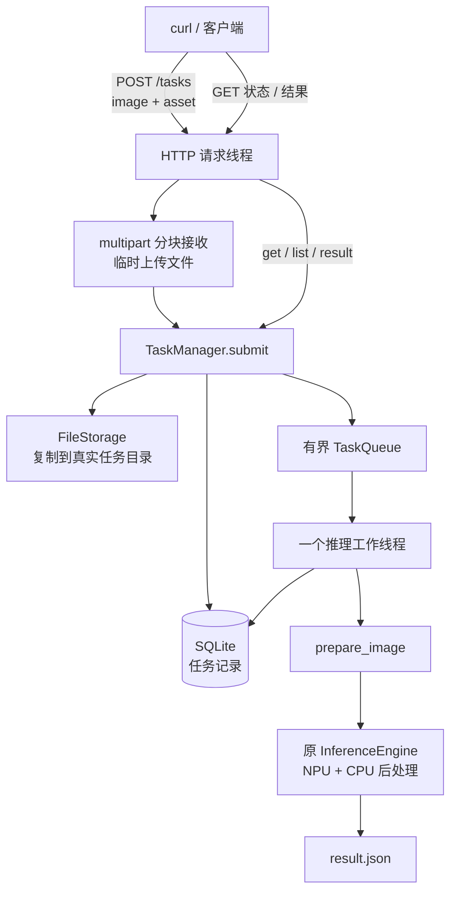

# 阶段三阅读指南：通过 HTTP 上传图片并查询推理任务

本指南对应已实现的阶段三代码。你不再需要在服务程序内部输入 `submit/get`；客户端通过 HTTP 发送请求，服务端继续复用阶段二的 TaskManager、SQLite、有界队列和单个推理工作线程。

当前范围：仅监听本机 `127.0.0.1` 的 HTTP 图片上传、状态/列表/结果查询、健康检查。保留阶段一单图 CLI 和阶段二本地交互入口。没有新增视频、网页、账号、HTTPS、取消任务、自动重试或中断恢复。

## 1. 先跑起来：一个终端运行服务，另一个终端发请求

### 1.1 编译

在项目根目录执行：

```bash
cmake -S . -B artifacts/build -DCMAKE_BUILD_TYPE=Release
cmake --build artifacts/build --parallel 2
ctest --test-dir artifacts/build --output-on-failure
```

HTTP 协议库 cpp-httplib 已以固定版本放入 `third_party/cpp-httplib/`，正常编译不需要联网下载。其许可证、版本、提交和文件哈希见 [依赖说明](../third_party/cpp-httplib/README.edgeinspect.md)。启用测试时需要 Python3 解释器，HTTP 测试只使用 Python 标准库。

模型、正常库和 RKNN/OpenCV/SQLite 等依赖仍按原项目要求提供。

### 1.2 终端 A：启动 HTTP 服务

```bash
artifacts/build/edgeinspect_http \
  --root "$PWD" \
  --data-root artifacts/http-service \
  --queue-capacity 10 \
  --port 8080
```

使用新的 data_root，不要用之前教学程序写过虚拟 QUEUED 记录的数据库。端口已被其他程序占用时，服务会报告 BIND_ERROR；不会让两个服务默默共享端口。

模型初始化成功、HTTP 监听线程启动后，终端输出：

```json
{"event":"HTTP_READY","listen":"127.0.0.1","port":8080,"engine_initializations":1}
```

这条启动命令没有图片路径或 asset，因为它启动的是持续运行的服务。图片由下一步请求提交。

### 1.3 终端 B：检查服务

在开发板上的另一个终端执行：

```bash
curl -sS http://127.0.0.1:8080/health
```

正常返回 HTTP 200：

```json
{"status":"READY","engine_initializations":1}
```

### 1.4 上传图片与部件类别

在项目根目录执行：

```bash
curl -i \
  -F 'image=@samples/normal.jpg' \
  -F 'asset=glass-insulator' \
  http://127.0.0.1:8080/tasks
```

解释：

- `-F` 创建 multipart/form-data 表单。
- `image=@...` 中的 `@` 表示 curl 读取客户端文件并上传文件内容。
- `asset=...` 是普通文字字段。
- 不需要自己填写 Content-Type 或 boundary，curl 自动生成。
- 服务器收到的是图片字节，不是客户端的文件路径。客户端文件名不参与服务端路径拼接。

接受后返回 HTTP 202，响应头 Location 指向状态查询地址：

```json
{
  "task_id": "bc76929032275b83d5f94ea6b1e5e780",
  "status_url": "/tasks/bc76929032275b83d5f94ea6b1e5e780",
  "result_url": "/tasks/bc76929032275b83d5f94ea6b1e5e780/result"
}
```

ID 每次随机生成，示例 ID 不可直接拿来查你的任务。202 表示输入已保存且任务已接受，不表示图片正常，也不表示推理已经完成。任务很快时，收到 202 时它也可能已开始甚至结束，所以响应没有硬编码 `status=QUEUED`。

### 1.5 查询状态和结果

把下面变量替换为刚收到的真实 ID：

```bash
TASK_ID=bc76929032275b83d5f94ea6b1e5e780
curl -sS "http://127.0.0.1:8080/tasks/$TASK_ID"
curl -sS "http://127.0.0.1:8080/tasks/$TASK_ID/result"
curl -sS 'http://127.0.0.1:8080/tasks?limit=20'
```

状态查询中的 status 仍是阶段二四种状态。结果地址在成功后返回已有 `result_json()` 生成的 JSON：异常分数、目标框、fallback、哈希、耗时和运行环境。没有阶段一 CLI 最外层的 `runs` 数组。

未完成时结果接口返回 409 / NOT_READY；任务失败则返回 409 / TASK_FAILED，错误详情通过状态接口读取。客户端可以隔一段时间再次查询状态；HTTP 层没有占住请求等待推理完成的 `/wait` 接口。

### 1.6 正常停止

在终端 A 按一次 Ctrl+C，或从另一个终端对该进程发送 SIGTERM。顺序是：

```text
停止接受新 HTTP 连接
    → 等待正在处理的 HTTP 请求线程结束
    → TaskManager 停止接收
    → 排空已经接受的任务
    → join 推理工作线程
    → 释放模型、数据库和临时上传目录
```

HTTP 程序不读取标准输入，输入 `quit` 不会关闭它；`quit` 是阶段二本地交互程序的命令。

这是基础正常关闭，不是阶段四的完整停止/恢复机制。SIGKILL、断电、驱动永久卡死、强制终止后的任务恢复尚未实现。

## 2. 三个程序，三个独立入口

| 可执行程序 | main 所在文件 | 使用方式 |
| --- | --- | --- |
| edgeinspect_cli | apps/infer.cpp | 启动参数直接指定一张图片，完成后退出 |
| edgeinspect_tasks | apps/tasks.cpp | 启动后从标准输入接收 submit/get/list 等命令 |
| edgeinspect_http | apps/http.cpp | 启动后从 HTTP 接收上传和查询请求 |

HTTP 程序不经过 infer.cpp 或 tasks.cpp。三个入口最终复用已有推理引擎，任务和 HTTP 两个入口还共用 TaskManager。



HTTP 请求线程不会调用 `engine.infer()`。因此多个客户端同时上传，不会变成多个线程同时访问同一个 RKNN context。

## 3. 先按这个顺序读代码

| 顺序 | 文件 | 主要问题 |
| --- | --- | --- |
| 1 | [apps/http.cpp](../apps/http.cpp) | 启动参数如何变成任务系统配置和 HTTP 配置？ |
| 2 | [http_server.h](../include/edgeinspect/http_server.h) | HTTP 适配层提供什么接口？ |
| 3 | [http_service.cpp](../src/http_service.cpp) | 谁启动 TaskManager，何时输出 HTTP_READY，怎么正常退出？ |
| 4 | [http_server.cpp](../src/http_server.cpp) | 路由如何调用 TaskManager？上传怎样读和清理？ |
| 5 | [task_manager.cpp](../src/task_manager.cpp) | HTTP 之后如何复用阶段二的真实推理？ |
| 6 | [http_api_test.py](../tests/http_api_test.py) | 如何稳定制造满队列、非法请求和系统故障？ |
| 7 | [validate_stage3.py](../tests/validate_stage3.py) | 如何通过真实 HTTP 验证 NPU 结果？ |

不用先读第三方 80 多万字节的 httplib.h；先掌握自己的路由和回调，再根据具体接口查上游文档。

## 4. apps/http.cpp：启动配置

| 参数 | 默认值 | 作用 |
| --- | --- | --- |
| --root | 当前目录 | RKNN 模型和正常库所在根目录 |
| --data-root | 必填 | 数据库、任务文件及临时上传目录所在根目录 |
| --port | 8080 | 本机端口；0 表示由系统选空闲端口，日志会打印实际端口 |
| --queue-capacity | 10 | 等待任务数，不包含正在运行的一张图片 |
| --max-bytes | 33554432 | 单张图片字节上限，同时传给 HTTP 上传层和原任务系统 |
| --max-pixels | 24000000 | 原预处理阶段的总像素限制 |
| --help | — | 打印帮助，不启动模型 |

没有 --host 参数，监听地址固定为 127.0.0.1。本阶段也不接受请求里传服务器本地路径来创建任务。

`TaskManager manager(tasks)` 准备存储、数据库和队列；`run_http_service(manager,http)` 再负责绑定、启动工作线程、启动 HTTP 和控制生命周期。

## 5. http_service.cpp：主线程、监听线程和退出

这里有四个层次：

| 线程/组件 | 做什么 |
| --- | --- |
| 控制主线程 | 等待 SIGINT/SIGTERM，控制关闭 |
| HTTP 监听线程 | 接受 TCP 连接、调用 HTTP 库 |
| HTTP 请求线程池 | 固定 4 个线程，处理上传和查询 |
| 推理工作线程 | 阶段二的 1 个线程，串行处理任务，复用模型 |

原检索内部还使用 OpenMP。这不是只用一个 CPU 线程的程序，也不是 4 个 HTTP 线程对应 4 个 NPU 引擎。

`Signals` 在启动工作线程前，通过 pthread_sigmask 阻塞 SIGINT/SIGTERM；新线程继承这个设置。主线程用 sigtimedwait 同步接收信号，避免在异步信号处理函数里执行 mutex、iostream、join 等操作。

监听线程以 `listen()` 阻塞运行；主线程确认 HTTP 库进入 running 状态后打印 HTTP_READY。启动失败不会打印假 READY。

只在 HTTP 请求结束后调用 manager.stop_and_drain()，这样已经接收中的上传可以完成提交或返回错误，随后再排空任务。

推理工作线程发生系统故障后，HTTP 仍可供查询任务和健康状态；健康检查返回 503，后续提交拒绝。收到正常退出信号后以非零码报告服务故障。

## 6. http_server.cpp：接口合同

| 请求 | 成功响应 | 主要用途 |
| --- | --- | --- |
| GET /health | 200，status=READY | 检查服务是否有系统故障 |
| POST /tasks | 202，ID 和状态/结果链接 | 上传一张图片并接受一个任务 |
| GET /tasks?limit=20 | 200，`{"tasks":[...]}` | 最近任务列表，limit 范围 1..1000 |
| GET /tasks/ID | 200，TaskRecord JSON | 查询当前状态、时间、路径和错误 |
| GET /tasks/ID/result | 200，推理结果 JSON | 获取成功任务结果 |

只接受明确的查询参数；例如重复 limit、limit=0、未知参数会拒绝。任务 ID 要符合 32 位小写十六进制格式；格式不对是 400，格式正确但不存在是 404。

上传严格要求 multipart/form-data，恰好两个字段，顺序不限：

| 字段 | 类型 | 要求 |
| --- | --- | --- |
| image | 文件 | 非空、不超过 max-bytes，文件名不作为服务端路径 |
| asset | 文字 | 非空、不超过 128 字节，属于现有五类正常库 |

允许的 asset 仍是 glass-insulator、lightning-rod-suspension、polymer-insulator-upper-shackle、vari-grip、yoke-suspension。请求不能覆盖模型、输出目录或分数阈值。

文件扩展名和客户端 MIME 类型不被当成图像有效性的证明。图片是否真的可解码、是否超像素限制，在工作线程的原 prepare_image() 中检查，所以一张坏图片也可能先获得 202，随后记录为 FAILED。

常见错误：

| HTTP 状态 | error_code 示例 | 含义 |
| --- | --- | --- |
| 400 | INVALID_ARGUMENT / INVALID_ASSET | 字段、参数或类别不合法 |
| 404 | NOT_FOUND | 路由或任务不存在 |
| 409 | NOT_READY / TASK_FAILED | 当前没有成功结果 |
| 413 | PAYLOAD_TOO_LARGE | 图片或整个请求体超限 |
| 415 | UNSUPPORTED_MEDIA_TYPE | 未使用 multipart，或请求体采用了不支持的编码 |
| 429 | QUEUE_FULL | 等待任务队列满，返回 Retry-After: 1 |
| 503 | NOT_ACCEPTING / SERVICE_FAULT | 任务系统不再接收，或存在系统故障 |
| 500 | DATABASE_ERROR / STORAGE_ERROR / INTERNAL_ERROR | 持久化或请求处理错误 |

错误体统一为 error_code/error_message。HTTP 协议层某些拒绝使用通用 HTTP_ERROR。网络断开或连接池过载时，也可能收不到应用 JSON，客户端仍要处理连接错误。

202 不等于任务成功，SUCCEEDED 不等于图片正常。分数、fallback、空阈值和空异常判断的语义保持原样。

## 7. 上传如何从网络变成真实任务

按 `Impl::submit()` 阅读：

```text
检查请求类型与服务状态
    → 创建本请求专用临时文件
    → ContentReader 按 multipart 分块读取
        → 字段头回调：检查名称、类型、重复和数量
        → 数据回调：asset 存小字符串，image 直接写临时文件
    → 检查完整性、必填字段和图片非空
    → 关闭临时文件，确认写入成功
    → manager.submit(临时路径, asset)
        → 原 FileStorage 保存真正任务副本
        → 原 SQLite 登记，原队列发布
    → 返回 HTTP 202 和任务链接
    → 请求结束，自动删除临时上传文件
```

输入没有先整体放进 `req.body`，使用 HTTP 库的 streaming ContentReader。回调内部异常会先记录，返回 false 停止读取，再在路由层统一转换成 HTTP 错误，避免错误丢失。

本阶段采用“先落临时文件，再调用原文件路径接口”的方案，减少对已验证任务层的改动。代价是接受成功前有一次额外的磁盘复制；以后若测量表明它是瓶颈，再设计直接接收至受控任务存储的事务边界。

POST 响应关闭本次连接，避免拒绝一个未读完的上传后，剩余字节被误当成下一条请求。

## 8. 文件位置、限制和清理

运行中数据类似：

```text
artifacts/http-service/
  .lock
  tasks.sqlite3
  .http-uploads-随机后缀/       当前 HTTP 进程的临时上传目录
    image-随机后缀             仅请求期间存在
  tasks/
    <task-id>/
      input.bin                真实图片压缩字节副本
      result.json              成功结果
```

- 临时目录由 mkdtemp 创建，临时文件由 mkstemp 创建，客户端文件名完全不参与路径构造。
- 图片数据单独计数，超过 max-bytes 立即拒绝；asset 单独限制 128 字节；最多两个 multipart 部分。
- 整个 HTTP body 上限是 max-bytes + 16 KiB，用于限制表单边界和字段头等额外开销。正常小表单够用，超长元数据也会被拒绝。
- 同样支持有 Content-Length 或 chunked 的上传，测试覆盖两种超限。
- 不启用 gzip 等请求体解压路径；请求必须不压缩。
- 接受、拒绝、断开上传都会释放请求临时文件；正常关闭清理本进程临时目录。
- 任务被拒绝时，原 TaskManager 仍负责清理尚未发布的任务目录，不留下孤立 QUEUED 记录。
- 读/写等待超时为 5 秒，keep-alive 空闲超时为 2 秒；这是网络 I/O 等待限制，不是 NPU 超时，也不是整次上传的总时间上限。
- HTTP 池固定 4 个线程、最多 16 个等待连接，与 queue-capacity 的推理任务容量分别管理。

进程崩溃可能遗留临时目录和未完成任务；当前不扫描恢复。完整中断对账、清理策略、历史任务保留期限、磁盘配额和 systemd 仍属于后续工作。

## 9. 客户端不一定和服务在同一个终端

curl 是一个独立客户端进程。每次 curl 请求都通过 TCP 到同一个长期存在的 HTTP 服务，不会每张图片重新加载模型。

当前地址 127.0.0.1 是开发板本机。如果在笔记本上执行这个地址，它指向笔记本自身，不是开发板。需要远程开发时可通过 SSH 本地转发访问板端回环服务，例如把下面用户名和地址替换为实际值：

```bash
ssh -L 8080:127.0.0.1:8080 ubuntu@开发板IP
```

再在笔记本上访问 http://127.0.0.1:8080，上传路径也指向笔记本的文件。本程序仍保持回环监听。本阶段没有直接对局域网开放的配置，也没有部署认证和 HTTPS。

## 10. 构建依赖怎么组织

```text
edgeinspect_http
    → edgeinspect_http_lib
        → src/http_server.cpp
        → src/http_service.cpp
        → edgeinspect_tasks_lib
            → 原 TaskManager / TaskQueue / SQLite / FileStorage
            → edgeinspect_engine
```

cpp-httplib 的类型只出现在 HTTP 实现 .cpp 中，公共 http_server.h 使用 PImpl。这样任务层和推理层不需要包含 HTTP 库头文件。

CMake 把 third_party/cpp-httplib 作为 HTTP 库的私有 SYSTEM include。第三方代码原样保存，MIT LICENSE 随源码保留。HTTP/TLS/压缩选项没有接入新的 OpenSSL 或 zlib HTTP 依赖；原引擎仍用 OpenSSL 计算 SHA256。

## 11. 测试：哪些是模拟，哪些是真实推理

### 确定性 HTTP 测试

```bash
ctest --test-dir artifacts/build --output-on-failure
```

新增 edgeinspect_http_api 测试通过 Python 标准库发真实 TCP/HTTP 请求，但服务进程使用 `tests/http_fixture.cpp` 的可控处理器。它不执行 NPU，能稳定制造：

- 一个任务运行时另一个排队，第三个被 429 拒绝。
- pending 的结果返回 409，失败任务返回 TASK_FAILED。
- 错误字段、重复字段、缺字段、空图片、非法类别、无效 ID、错误 limit。
- 普通及 chunked 图片超限、整个 body 超限、损坏 multipart、上传中途断开及临时文件清理。
- 多客户端并发，仍只有一个处理器初始化且不重叠调用。
- 端口占用启动失败、SIGTERM 后排空任务。
- 注入数据库失败后 500/503，以及模拟设备故障。

只有测试专用二进制提供模拟工厂；实际 edgeinspect_http 始终使用真实 InferenceEngine，没有 --fake 参数。

### 真实板端 HTTP 联调

```bash
python3 -B tests/validate_stage3.py
```

脚本启动真实 edgeinspect_http，上传两张本地样例和一张坏图，检查状态、结果、持久化、重启查询和启动失败，再与原 edgeinspect_cli 的结果精确比较。每次运行创建新的 artifacts/runs/stage3_* 目录，记录日志和 report.json。

### 本次验证记录（2026-11-10）

- 所有目标编译成功。
- CTest 4/4 通过：HTTP API、阶段二任务系统、原 core、检测协议；其中 HTTP 专项包含 61 个确定性检查。
- 真实 HTTP/NPU 联调 23 项通过，报告见 [stage3 report](../artifacts/runs/stage3_20261110_112053_105638/report.json)。
- 阶段二真实联调复跑 22 项通过，报告见 [stage2 report](../artifacts/runs/stage2_20261110_112125_676084/report.json)。
- 正常图分数 `0.6873426511883736`，异常图分数 `0.7032674252986908`。分数、框、fallback、哈希等与阶段一 CLI 完全一致，不据此生成报警阈值。
- 推理、预处理和 third_party/insplad 数值源码没有因阶段三修改。冻结源码清单中仍有先前 apps/infer.cpp 注释/格式改动造成的哈希差异；未修改基准，不能据此声称原阶段一完整基础验证脚本已通过。
- 未执行外部冻结数据集的完整回归，没有视频、远程部署、HTTPS、断电恢复或全量 AUROC 结论。

artifacts 报告只存在本机且被 Git 忽略，其他机器需自行运行脚本生成。

## 12. 自学时建议跟踪的调用链

```text
curl -F image=@... -F asset=...
    → apps/http.cpp::main
    → run_http_service
    → HttpServer::Impl 中注册的 POST /tasks
    → Impl::submit / ContentReader
    → TaskManager::submit
    → FileStorage / TaskRepository / TaskQueue
    → 原工作线程和 InferenceEngine
    → GET /tasks/ID
    → GET /tasks/ID/result
```

先跑一次正常任务，观察实际目录和数据库，再跑一次坏图片，最后阅读队列满和数据库失败测试。下一阶段主要补中断恢复和服务部署，不需要重写现有推理算法。
